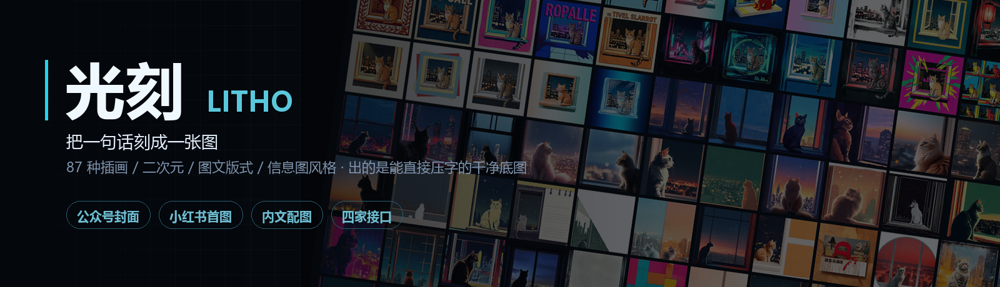
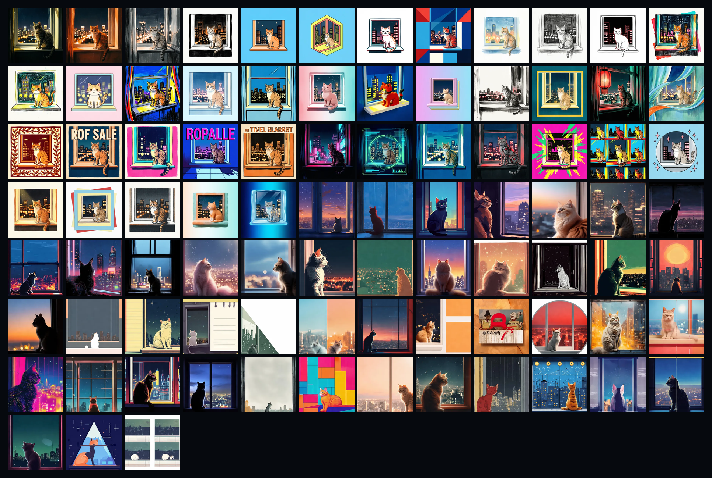

# 光刻 LITHO

**说一句话，出一张能直接压字的干净底图。**

87 种插画 / 二次元 / 图文版式 / 信息图风格 · 中文提示词编译 · 四家出图接口可在面板里直接填 key。

为公众号封面、小红书首图、内文配图做的。

---

## 它解决什么

**一、你不知道该选什么风格。**
87 种风格，每一种都配了一张真实的预览图（同一只猫、同一个窗台，只换画风）。不用读名字，看颜色和质感就知道合不合你的内容。

**二、你会写句子，但写不出提示词。**
输入框里写「AI芯片」就行。点「帮我扩写」，或者让它自动补全——它会把这个词补成一段能画出来的画面描述：主体什么样、在哪、光从哪来、有什么决定性细节。中文提示词里**不会出现任何色号和参数**（实测写 `#FF2E88` 模型会把这行字画进画面）。

**三、出了图也用不了。**
默认按平台出正确比例（公众号头图 2.35:1、小红书 3:4、方图 1:1），上方留出压标题的干净区。中文标题一律后期叠——**模型写中文字必翻车**，这是 87 次实测的结论，所以插件只管底图。

---

## 87 种风格



15 个大类：写实 4 · 扁平 6 · 手绘 5 · 卡通 4 · 潮玩 5 · 国风 5 · 复古 8 · 科技 5 · 孟菲斯波普 3 · 肌理 4 · 商务 3D 3 · 二次元 9 · 图文版式 11 · 编辑设计 9 · 信息图 6。

**图文版式**（清单大字 / 手绘便签 / 备忘录界面 / 聊天记录 / 左右对比 / 数字清单 / 拍立得拼贴 / 知识卡片 / 环形标注 / 实景涂鸦 / 九宫格）和**信息图**（步骤流程 / 时间线 / 四象限 / 数据图表 / 金字塔 / 对比表格）是给"图即内容"那类笔记做的——小红书把图片信息密度的权重提上去了，纯风景图撑不住干货。

---

## 安装

```bash
dsh plugin add dsh-guangke
```

或者：**插件 → 发现**里搜「光刻」。

装完侧栏多一个「光刻」，点开即用。

---

## 配接口

右上角齿轮，四家选一个填 key（存在 `~/.dsh/forge-studio/config.json`，不进代码）：

| 接口 | 模型 | 说明 |
|---|---|---|
| **火山方舟**（推荐） | `doubao-seedream-5-0-flash-260915` | 最快最稳，无水印，支持任意宽高比。控制台要先开通 Seedream |
| 阿里百炼 | `qwen-image-2.0` | 同步出图、无水印。`prompt_extend` 必须关，否则它会把「上方留白」改掉 |
| 智谱 CogView | `cogview-3-flash` | **永久免费**，但右下角「AI生成」水印关不掉，只能裁 |
| 自定义 | 任意 OpenAI 兼容 | 硅基流动、中转站、本地 vLLM 都行 |

填完点「测一下」，出图成功会显示耗时。

---

## 用法

1. 写一句话：`一块巨大的 AI 芯片悬浮在夜色里`
2. 点「帮我扩写」，或勾上「短句自动补全画面」（18 字以下自动展开）
3. 选一张风格卡片、选用途，点「生成图片」

七到十五秒出图，落在 `~/.dsh/forge-studio/out/`。

### 0.2 新增的三件事

**一次出四张。** 工具条上勾「一次出 4 张」，串行跑——不是并发，百炼那边 4 并发必撞 429。第二张起复用第一张的扩写结果，不重复烧 token。中途遇到欠费或 key 错会立刻停，不空转。

**叠标题。** 图出来以后在下面那行填标题和英文副标，点「叠标题」，程序用 Pillow 把字压上去——左侧渐变压暗、高斯发光、金色细线、英文拉开字距。字号跟随图片尺寸自动算。

这条路比让模型直接写字靠谱得多：qwen-image 和 Seedream 写中文字都会糊，而且**提示词里只要出现「标题」两个字，它就真给你画一行字**，写「不要文字」也压不住。所以生成一律当无字处理，字全交给这一步。

**出图历史。** 最近 40 张会在面板底部铺开，点一下就换主图、可以继续叠字。文件本体在 `~/.dsh/forge-studio/out/`，直接拿去做封面也行。

---

## 实测踩出来的坑（都修了，写在这免得你再踩）

| 现象 | 真因 |
|---|---|
| 画面里冒出色号 `#0A0A12 / #FF2E88` | 中文提示词里写了 hex，模型当正文画。已全部转成「深天蓝」「荧光红」这类中文颜色词 |
| 右上角固定出现三个乱码汉字 | 风格描述里有「留给标题」——qwen-image 见到「标题」二字就真给你画一行字。全库已净化，写「不要文字」也没用，得从源头删词 |
| 图片顶部一条纯白硬边 | 留白文案写成「干净留白」，模型给你刷一块白。改成「偏暗、低细节的背景区域」才有 |
| 宽幅图被切成两段，接缝是硬边 | 提示词写 2.35:1 但实际发的 1664x928。比例必须和 size 一致 |
| `--style 赛博` 出成国风赛博 | 模糊匹配按数组顺序命中。改成前缀优先 + 短名优先 |
| 画面越宽越容易长字 | 招牌、书脊、报头天然是文字载体。要干净底图优先方形 |
| 智谱出图存成 .png 打不开 | 它返回的是 jpeg。现在按文件头判扩展名 |

---

## 已知限制

- **中文标题必须后期叠**。模型写中文字 100% 崩，插件只保证底图干净。
- **图文版式类会画歪**。备忘录界面、聊天记录、数字清单这种要靠精确版式的，`qwen-image` 和 `seedream` 都会跑偏、会往格子里塞乱码字。这类要么给 Nano Banana Pro / GPT-Image，要么只出容器底图、字全后期加（小红书封面实际就是这么做的）。
- 智谱通道有水印，裁剪后可用。

---

## License

MIT © LITHO contributors
